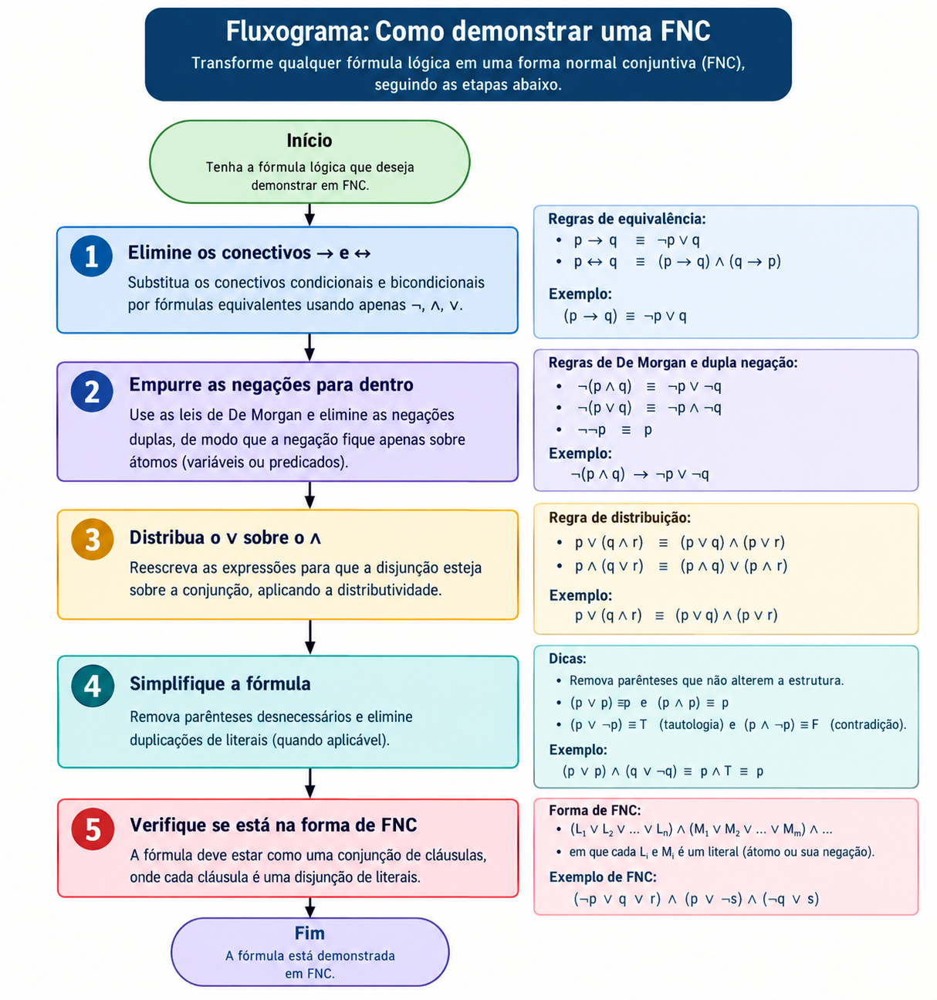

# Fluxograma: Como demonstrar uma FNC

O fluxograma abaixo resume as etapas para converter uma fórmula lógica em **Forma Normal Conjuntiva (FNC)**.

## Observação

Na lógica de predicados, o procedimento também pode exigir a padronização das variáveis ligadas, a conversão para a forma prenex e a skolemização para eliminar os quantificadores existenciais. Os quantificadores universais ficam implícitos na FNC.

Uma fórmula está em FNC quando é uma **conjunção de cláusulas**, sendo cada cláusula uma **disjunção de literais**.
